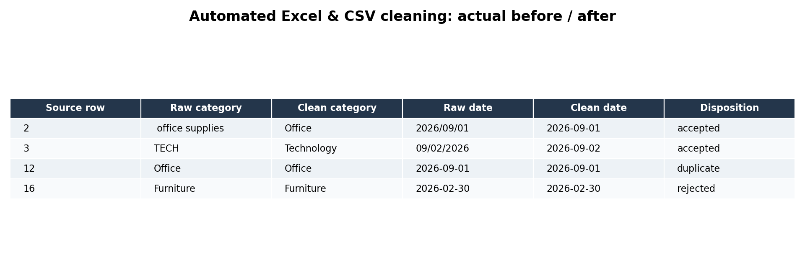
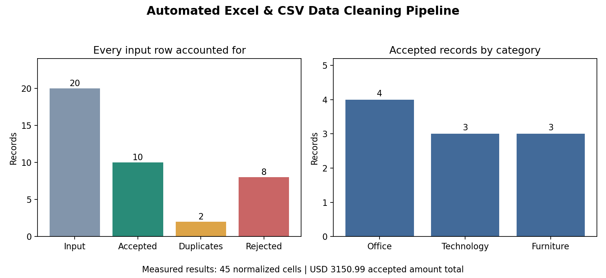

# Automated Excel & CSV Data Cleaning Pipeline

A small reusable Python pipeline for cleaning messy order records, validating data, removing duplicates, and exporting CSV/XLSX with a row-level audit. No paid APIs or frontend. Original files are never edited.

## Run locally

Python 3.10+ (tested with Python 3.13.9, pandas 2.3.3, openpyxl 3.1.5, matplotlib 3.10.6). From this folder:

```bash
python -m pip install -r requirements.txt
python pipeline.py --input sample_input/messy_orders.csv --output prepared_csv
python pipeline.py --input sample_input/messy_orders.xlsx --sheet Orders --output prepared_excel
python -m unittest -v
python make_figures.py
```

Skip installation if dependencies are already installed. pandas and openpyxl run the pipeline; matplotlib is used only for figures. Output folders must be new; existing folders are rejected. `make_figures.py` defaults to the included `sample_output`; to illustrate a new run:

```bash
python make_figures.py --output prepared_csv --portfolio new_figures
```

## Input and rules

CSV (UTF-8) or XLSX with exactly these columns; header whitespace/case is normalized:

```text
order_id, customer, email, category, order_date, amount, status
```

- Required: every field except email. Required blanks are rejected; optional missing emails remain blank.
- Trim/collapse whitespace; uppercase IDs; lowercase emails. Customer capitalization is preserved.
- Category aliases map office/office supplies to Office, tech/technology to Technology, and furniture to Furniture.
- Status aliases map paid/complete/completed to Paid, pending to Pending, and canceled/cancelled to Cancelled.
- Dates accept `YYYY-MM-DD`, `YYYY/MM/DD`, `MM/DD/YYYY`, and English `DD-Mon-YYYY`. Slash dates such as `09/02/2026` explicitly mean September 2. Output uses ISO dates. Impossible dates are rejected.
- Amounts use USD-style numbers, optional `$` and correctly grouped commas, and at most two decimal places. Zero is valid; negative, missing and malformed amounts are rejected. Totals use Decimal; XLSX exports numeric amounts and real dates.
- Email validation is a basic syntax check, not address verification.
- Validate first, remove exact duplicates across all normalized columns (keep first), then reject all remaining valid records sharing a conflicting order ID. Duplicates of a conflicting record still have the duplicate disposition. No conflicting value is chosen automatically.

Aliases and date formats are parameterized. `--rules rules.json` can replace any of `category_aliases`, `status_aliases`, or `date_formats`. Alias keys must be lowercase/casefolded; replacing an alias dictionary replaces that whole dictionary. Example (save as `rules.json` before running the command below):

```json
{"date_formats": ["%Y-%m-%d", "%d/%m/%Y"]}
```

```bash
python pipeline.py --input sample_input/messy_orders.csv --output custom_run --rules rules.json
```

Reusable functions (`read_input`, `normalize_row`, `clean`, `run`) live in `pipeline.py`. This is an order-record template, not a universal cleaner for arbitrary schemas; other schemas require an explicit adaptation.

## Included structure

```text
excel-csv-cleaning-automation/
  pipeline.py
  make_sample.py
  make_figures.py
  test_pipeline.py
  requirements.txt
  README.md
  LICENSE
  sample_input/
    messy_orders.csv         # 20 original synthetic records
    messy_orders.xlsx        # same records, sheet Orders
  sample_output/
    cleaned.csv              # 10 accepted records
    cleaned.xlsx             # Summary + Cleaned sheets
    before_after.csv         # every raw/normalized row and disposition
    rejected.csv             # rejected rows and reasons
    report.json              # measured metrics and applied rules
    report.md
  portfolio/
    before-after.png
    cleaning-summary.png
```

## Actual executed results

| Metric | Result |
|---|---:|
| Input rows | 20 |
| Cleaned/accepted rows | 10 |
| Normalized duplicates removed | 2 |
| Rejected rows | 8 |
| Cells whose normalized values differ from input | 45 |
| Missing input cells | 4 |
| Accepted records with optional blank email | 2 |
| Accepted amount total (USD) | 3,150.99 |
| Accepted amount mean (USD, rounded) | 315.10 |

Reconciliation: **20 = 10 accepted + 2 duplicates + 8 rejected**. Normalized-cell counts include all input rows, including rejected and duplicate records. Category counts are Office 4, Technology 3, Furniture 3. Status counts are Paid 7, Pending 2, Cancelled 1.

Rejections: one missing customer, one missing amount, one impossible date, one unknown category, one negative amount, one invalid email, and two conflicting order-ID records. See [report.md](sample_output/report.md) for source row numbers.

## Before / after examples

| Field | Before | After |
|---|---|---|
| ID | ` o001 ` | `O001` |
| Customer | ` Alice   Chen ` | `Alice Chen` |
| Email | ` ALICE@EXAMPLE.COM ` | `alice@example.com` |
| Category | ` office supplies ` | `Office` |
| Date | `2026/09/01` | `2026-09-01` |
| Amount | `$120.00` | `120.00` |
| Status | ` PAID ` | `Paid` |

`2026-02-30` remains visible in the audit with a rejected disposition; the pipeline does not invent a replacement date. Audit `clean_*` columns contain attempted normalization, not a guarantee of acceptance—read the disposition column.




## Reproduce from scratch

In a fresh empty sample workspace, copy the Python scripts and requirements file, install dependencies if needed, then run:

```bash
python make_sample.py
python pipeline.py --input sample_input/messy_orders.csv --output sample_output
python make_figures.py
python -m unittest -v
```

The included sample folders already exist, so do not run this regeneration block over them. `make_sample.py` refuses to overwrite sample input. The quick-run block above uses new output directories instead.

Tests cover CSV/XLSX equivalence, source hashes, row reconciliation, known errors, conflict handling, duplicate removal, idempotent cleaning, repeatable metrics, zero/missing distinctions, explicit date rules, schema checks, typed XLSX dates/numbers, filters, freeze panes, and overwrite protection. Both exported sheets and portfolio figures were visually reviewed through previews derived from saved workbook values.

The workbook summary is a run snapshot; rerun the pipeline to refresh it. XLSX formulas/macros/styles from input are not preserved. Multi-sheet workbooks process one sheet per invocation. A failed export can leave partial output; fix the cause and rerun into a new folder.

## Upwork portfolio description

**Automated Excel & CSV Data Cleaning Pipeline**

I built a reusable Python pipeline that converts messy Excel and CSV order records into validated, consistent exports. It normalizes text, categories, dates, and amounts; removes normalized duplicates; and separates invalid records with clear reasons. Missing optional values remain blank, while required missing fields and conflicting order IDs are flagged for review. The demo reconciles 20 input rows into 10 accepted records, 2 duplicates, and 8 rejected records. Deliverables include cleaned CSV/XLSX files, a before/after audit, and concise summary statistics. CSV and Excel inputs were tested to produce identical results while preserving originals.

## Suitable client tasks

Spreadsheet cleanup, CSV normalization, duplicate removal, date/category standardization, order-data validation, Excel/CSV conversion, and repeatable report generation. Synthetic records and example.com addresses are original demonstration data.

## License

MIT; original synthetic sample data uses the same license.
